# 2077 模组翻译器 (Cyberpunk 2077 Mod Translator)

把《赛博朋克 2077》模组里的可翻译文本提取成表格，人工填中文，再一键写回模组源文件的桌面工具。

当前版本：**v2.42.2**

## v2.42.2 更新：批量崩溃与续跑

批量翻译跑到第 28 个 mod 时整窗消失（事件日志 `0xc0000005` / `python314.dll`，
10:17 和 10:26 各一次）。原因是后台线程直接调 `window.evaluate_js` 往界面推事件，
那是跨线程碰 WebView2 的 UI 线程，单次没事，连着跑几十个 mod 才会踩中。

- **事件改成前端轮询**：批量线程只往队列里塞，JS 每 150 ms 取一次，后端线程不再碰 COM。
- **续跑**：每个 mod 跑完记一行 `userdata/batch/run.jsonl`，重跑跳过已完成的，
  界面会显示「跳过上次已完成的 N 个」；改了模型/目标语言/复制选项就整份作废。
- **现场**：`userdata/logs/crash.log`（`faulthandler`，含所有线程的 Python 栈）
  与 `userdata/logs/batch.log`（每个 mod 的 start/done），下次真崩了能直接定位。

## v2.42 更新：批量队列换成单模组流程

原来那个「扫描游戏目录里的 `.xl`、只写输出目录」的批量队列整个删掉了。它只认
`.archive` 里的 CR2W 本地化，永远看不到 `.reds` / `.lua` / 语言包 json —— 实测
286 个已装模组它只能认出 74 个、2459 行，而单模组的三层提取是 101 个、16126 行。

新批量的做法是**把单模组流程跑 N 遍**：

```
复制整目录 → _do_load 三层提取 → 只翻未译行 → _do_apply 写回副本
```

- **复制**：每个模组复制到 `userdata\batch\out\<mod名>\`（固定 latest，重跑覆盖）。
  贴图 / 音频 / 视频 / 字体默认跳过——它们不参与翻译，往往占九成体积。
  `.archive` 也默认跳过，勾「包含归档层」才复制（纯归档汉化的模组需要它）。
- **会话隔离**：每个模组派生一个独立的 `Api` 实例（`spawn_worker`），
  `rows` / `root` / `meta` / `l10n_session` / `_stop` 全分开，
  表格里那个会话不受任何影响；翻译记忆与术语表共享同一份，不重复读盘。
- **原目录只读**：staging / 游戏目录一个字节都不写。写回发生在副本上，
  撤销记录也指向副本。
- **预扫**：只扫明文层，286 个目录 33 秒，能提前算出每个模组的「待翻 / 已有中文」，
  待翻 0 行的直接标「无需翻译」，不复制、不翻译。

顺带删掉的东西：`src/localization/batch.py`（entryId 迁移快照那套）、
`queue_info/scan/start/cancel/results/forget` 六个 API、前端旧队列面板。
旧的 `userdata\batch\index.json` / `state.json` 也清掉了。

已知问题（既存，属于后续单模组优化）：lua 语言包的目标文件名固定用
`TARGET_NAMES["zh-CN"]["lua"] = "zh_CN"`，而实际模组里 5 个用的是 `zh-cn.lua`，
游戏按 `localization/zh-cn` 加载，所以对这些模组生成的 `zh_CN.lua` 不会被读到。
`ChineseSimplified.reds`（35 个）不受影响。

v2.42.1：工具条那一行按钮不换行，窗口窄时右侧会被裁，先把「导出 Excel」收进了
「更多」菜单。

## v2.41 更新：按「位置」拦标识符

v2.40 那批修复之后还剩一类损坏：**形态完全正常的单词，但站的位置是名字**。

```
call(sys, "Renew")                       -- CET 远程调用：第二个参数是 Redscript 方法名
host.cname("None")                       -- CName
slotWorldPosition(c, "Head")             -- 引擎插槽名，经本地包装函数中转
"meta.read,perspective.read,events.push," -- 能力清单：点分逗号串
"takemura|story_takemura|q112_done|20"   -- 竖线 id 表
```

这些串的形状一点问题都没有，`looks_like_code_fragment` 一条都挡不住；翻掉的
后果是**静默失效**——文件照样编译、界面照样正常，只是方法调不到、插槽查不到、
语音池失配。实测 `Immersive Third Person` 2.0.0 的 304 行译文里有 14 处是这类
（`Renew` / `Release` / `Revision` 被翻成中文后，租约体系整个失效）。

v2.41 加了三条判据（`src/mod_text_engine.py` / `src/text_noise.py`）：

- **位置证据**：`call()` 的方法名位、`cname` / `StringToName` / `GetSlotTransform`
  的名字位、`Equals` / `StrSplit` 的比较位；被调名里带 `slot` / `bone` / `fact` /
  `tweakdb` 的调用，字符串参数一律当名字。已经是中文的字面量放行（否则历史
  译文连改都改不了）。
- **形状证据**：点分逗号清单（能力/协议）、竖线数据行，外加写回时的段数守卫。
- **查表键**：`getText` / `getTextOrKey` 的实参不再进候选。

全量 286 个模组 A/B：候选 6517 → 6476（-0.6%），只有两个已知损坏的模组变少，
其余 133 个一条都没动。详细分析见 `docs/P21位置证据.md`。

### 写回失败分成两级，并且不再一条坏行干掉整批

| 级别 | 判据 | 出口 |
|---|---|---|
| soft | 疑似代码碎片（可能误报） | 失败明细上给「仍要写入」，单条覆盖 |
| hard | 骨架不一致 / 数据行段数变了 / 能力清单 | 永远不写 |

骨架校验失败时改为二分找出肇事行，只拒那一条，同文件其余译文照常写回。
每条失败还能点「标记为代码」，记进 `userdata/user_skip.json`
（按相对路径 + 原文 sha1），以后加载直接不出现。

### 机翻与写回的对账

- 批量里被模型跳过的（空串 / 原样返回英文）不再静默丢弃：整批落盘后逐条补翻
  一次，提示词换成「保留 `{…}` 占位符与 `\n` 换行」；`{…}` ≥3 或 `\n` ≥4 的串
  一开始就走单条通道。
- 应用前对账：同批文件里还有没译的行会先提示「这次只会写回 N 条」。
- 写回后报「候选 / 写入 / 跳过」，差额看得见。

### 其余

- `getLabel=function() return "…" end` 这类**直接返回字面量**的显示名现在也会进表。
  以前它们一条判据都沾不上（前面不是 `label =`、也没有调用包装，长句兜底又要求
  首字母大写），`repeatable_ncpd_gigs` 的 5 个按钮名（`Show ID` / `Restore Prefab`
  / `Terminate Gig` / `Reset Gig` / `Reset Counts`）因此从来没被提取过。
- 归档层的译文与归档里已有内容一致时**不重新打包**（字节、时间戳、Vortex
  部署状态都不动）。
- `label="Restrict "..name` 这类拼接写回时保留原文首尾空格，面板不再显示
  「限制Japantown…」。
- 加载新模组前会确认「还有没应用的改动」；加载失败时路径输入框退回，不再让
  `state.modPath` 指向一个跟表格无关的目录。

## v2.28 更新：三层加载 + 标识符守卫

一个模组的文案通常散在三处：.archive 里的 onscreens、明文语言包、.reds/.lua 里的硬编码串。
以前工具分两条互不相通的入口，装哪一种都会漏掉另一种——`Auto Drive Enhanced` 这种
「.reds 只写 key、文案全在归档里」的模组，源码模式一条界面文本都看不到。

v2.28 把归档层并进同一个加载流程：三层合并成一张表，应用时按来源分流
（归档行出新 archive，明文行回写文件，互不覆盖）。

同时补上两条守卫：
- **标识符守卫**：同一个串若还在 `n"..."` / `t"..."` / `r"..."` / `StringToName()` 里出现，
  就不再当文案翻。翻掉显示位而漏掉标识符位，会让 `ModSettings.GetCategories(n"名字")`
  之类的查找静默失配，界面看着正常、功能已经坏了。
- **本地化键守卫**：`UI-Foo-bar-label` 这类查表键不参与源码翻译，它的译文在归档层。

另外：设置里新增「启用本地模型」开关（停用即释放显存），右键菜单新增「定位到已选择的行」，
选中行被筛选/隐藏时会自动取消选择，不再让编辑框和快捷键指向看不见的行。

**数据目录改为便携**：设置、记忆、语料、解包产物从 `%APPDATA%\2077ModTranslator`
挪到 `<程序目录>\userdata\`（exe 旁边），整个目录可以拷走；需要放到别处时用环境变量
`MT_DATA_DIR` 指定。

## v2.25 更新：官方译文做基线 TM

游戏本体自己有一套官方中文译文（16.4 万对 en→zh）。这套东西 v2.20 就存进库里了，
但只用在两个地方：资源模式和批量队列。**最常用的源码模式（.reds / .lua）根本没套**，
机翻前也不查它——整句命中官方译法的那部分，照样发给模型重翻一遍。

v2.25 把它扶正成「翻译记忆的第一层」。

### 三层优先级

```
手改(manual)  >  官方基线(official)  >  机翻记忆(machine)  >  模型
```

- 加载时、机翻前，三条路径（源码 / 资源 / 队列）现在都走同一个 `_baseline_fill`。
- 官方命中的行**不再发给模型**：省调用，而且术语天然和游戏一致。
- 你在表格里改过、并写回模组的译文会被记成「手改」，以后任何模组遇到同一句都直接复用，
  **机翻再跑一遍也顶不掉它**（以前 `memory.put` 是无条件覆盖，这是个隐性数据丢失点）。

### 短词要标「待核」

实测发现官方语料作为整句基线时，单词条会撞上同形的专名：

| 模组里的原文 | 官方语料给的 | 对不对 |
|---|---|---|
| `Crosshair` | 准星 | 对 |
| `Off` | 关 | 对 |
| `Mark` | 马克 | 错，官方里是人名 |
| `Pan` | 潘 | 错，官方里是姓氏 |
| `Title` | 歌名 | 错，官方里指唱片曲目 |

频次不能用来判别（`Mark` 出现 7 次，照样错；`Crosshair` 只出现 1 次，是对的）。
唯一站得住的分界是**词条长度**：多词短语歧义极小，单词才是漂移重灾区。所以分级：

- **多词短语 + 官方内部只有一种译法** → 稳，绿色条
- **单词条** → 照样填，但标「官方待核」，黄色条，筛选器可单独看

设置里可以关掉「单词条的官方命中也算」，那样只留稳的部分。

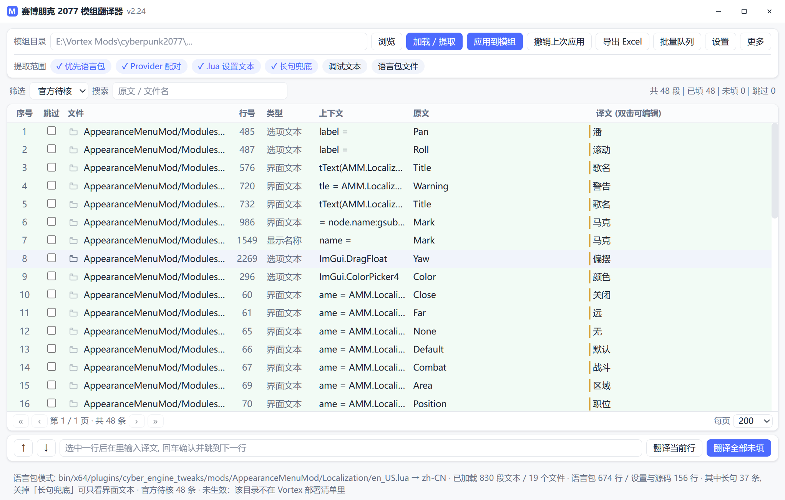

### 目标语言守卫

官方语料只有 en-us → zh-cn。以前目标语言选日语/英语时照样会把中文填进去，
现在直接跳过并说明原因：

```
官方基线未启用：官方语料只有英文→简体中文，目标语言是「日本語」时不套用
```

### 实测

| 模组 | 提取条数 | 官方稳 | 官方待核 | 待翻 |
|---|---|---|---|---|
| Appearance Menu Mod | 156（830 行） | 0 | 48 | 108 |
| Mod Configuration Menu | 281（523 行） | 1 | 3 | 277 |

AMM 那 48 条几乎全是 UI 单词（Close / Off / None / Default / Warning / Combat / Area…），
MCM 只有 4 条——它是框架，文案基本都是原创。**官方基线的适用面就是「短界面词」**，
不是「替掉机翻」，这一点必须说清楚。

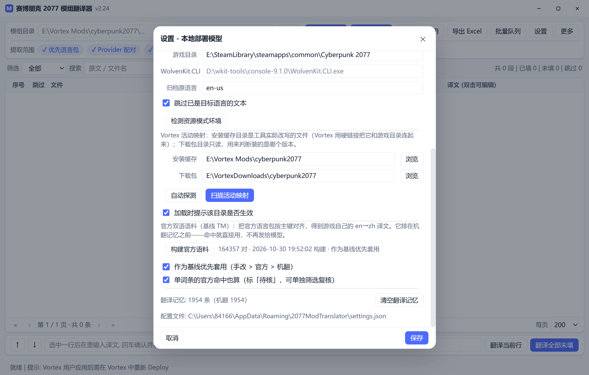

- 机翻回执里把「基线/记忆」拆开报：官方给了多少、记忆给了多少。
- 导出的 Excel 多一列「译文来源」（官方 / 官方待核 / 手改 / 记忆 / 机翻）。
- 详见 `docs/P10基线TM.md`。

## v2.24 更新：Vortex 活动映射 + 翻译失败回执

v2.23 之前，工具把「安装缓存目录」里的每个子目录都当模组翻。实测发现这个假设
是错的：**302 个目录里只有 194 个真的进了游戏**，剩下 108 个是更新时被替换掉的
旧副本。照着目录名翻，三分之一的工作量落在游戏永远读不到的文件上。

v2.24 把三层关系显式建出来，并且把机翻「没翻完」这件事第一次变成可操作的。

### 三层映射

```
下载包（只读，版本锚） -> 安装缓存目录（工具改写的文件） -> 游戏内文件
   名字含 modId+版本            Vortex 用硬链接连过去          deployment.msgpack
```

关键在第三层：`<安装缓存>\vortex.deployment.msgpack` 是 Vortex 每次部署都会重写的
清单，`files[].source` 就是「这个游戏文件属于哪个缓存目录」。**不出现在清单里的目录
= 没有生效**，这一条不需要猜。

- 设置里新增 **安装缓存目录** 与 **下载包目录**，都能「浏览」，也有 **自动探测**
  （从 `%APPDATA%\Vortex\vortex*.log` 里的 `stagingPath` / `archivePath` 反查，
  再用「目录里有没有 deployment.msgpack」验一遍）。

  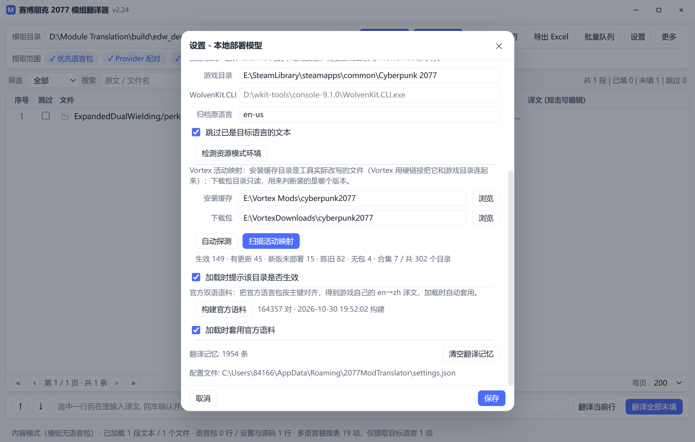

- **扫描活动映射** 会给出 302 个目录的分档，并打开映射面板（「更多 -> 活动映射…」）：

  | 状态 | 数量 | 含义 |
  |---|---|---|
  | 生效 | 149 | 已部署，游戏正在读 |
  | 有更新待装 | 45 | 已生效，但下载包里的版本更新 |
  | 新版未部署 | 15 | 新版下了，一个生效目录都没有 |
  | 陈旧未生效 | 82 | 历史副本，游戏读不到 |
  | 无下载包 | 4 | 手动装的，没有版本锚 |
  | 合集（不翻译） | 7 | `vortex_collection_*`，不是模组 |

- 版本判断做了归一化：`2-8-1` / `2.8.1` / `v2.8.1` 是同一个版本，`2.3` 和 `2.3.1`
  不是。直接字符串比较会把 45 个「真更新」和一堆写法差异混在一起。
- 面板里点一行把目录填进「模组目录」，双击直接加载；可复制清单成 TSV。
- **加载时会提示目录死活**：加载一个没生效的目录，状态栏会写明「未生效：该目录不在
  Vortex 部署清单里」，并弹一次提示——改动写进去游戏也读不到。

### 翻译失败回执

以前机翻中途失败只推一行红字，用户不知道还剩多少、该不该继续。现在每轮结束都会回执：

- **已翻译 / 未翻译 / 基线记忆 / 本次合计** 四个数字；
- **失败原因**（接口连不上、HTTP 500、模型返回空译文、手动停止）；
- **继续翻译剩下的** 只补没翻出来的那些行，已经翻好的不会重来；**确认** 关闭。
- 这个提示用 `z-index: 300`，盖在设置、队列等所有弹窗之上。

模型返回空串也算「没翻出来」，不再被当成成功。

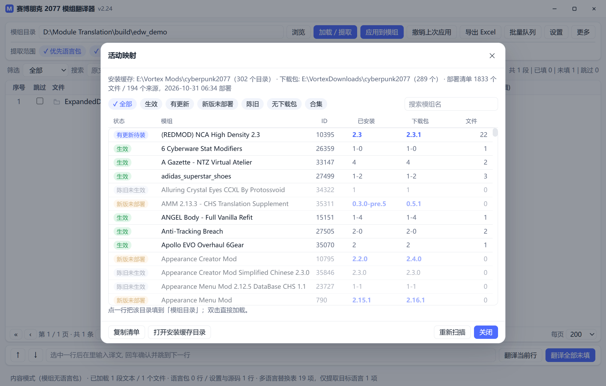
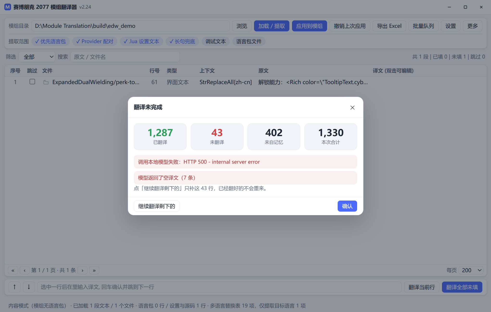

- 详见 `docs/P9活动映射.md`。

<!--
  文档说明（不渲染）：从下面这段起，较早的历史段落里有 735 处「□」。
  原因是 2026-10-31 一次编码事故：用 PowerShell 的 Get-Content/Set-Content 处理这个
  UTF-8 文件时，内容被按 GBK 误读后重新编码写回。已用 Windows CP936 码表逆向恢复了
  绝大部分，但每处仍丢失「一个汉字的 UTF-8 尾字节 + 紧随其后的一个 ASCII 字符」，
  这部分不可逆。产品代码与 docs/ 下的分阶段文档未受影响。
  原文残档保留在 README.mojibake.bak。
-->

## v2.23 更新：精简误报 + 更紧凑的界面

v2.22 把语言包和源码两层并到了一张表，代价是表格里混进了「像文本、其实不能翻□
的东西：图集转储、桥接函数签名、模组自带的双语对照表、同一份语言包的德语/朝鲜□
副本。v2.23 专门做减法，**一行代码都不碰产品的翻译能□*□

- **五类噪音，两条判定线**（`src/text_noise.py`）：

  | 家族 | 例子 | 什么时候过□|
  |---|---|---|
  | 资源转储 | `kb_a:64:64:0\|kb_b:32:32:1`、`common/masks (12)` | 任何档位 |
  | 记录□| `Items.tony_wet_t-shirt_red`、`Foo.Bridge::Hide;String` | 任何档位 |
  | 技术串 | `ORDER BY name ASC`、`walk dist=%.1f busy=%.1f`、`{drop_point}` | 任何档位 |
  | 外文□| `[en_us][pl_pl]Tego właśnie chciałaś?`、`확인`、`LACK` | 仅长句兜底档 |
  | 双语□| `["Wall Wood"]="墙木"` 里的 key | 任何档位 |

  外文表为什么只在长句兜底档过滤：模组确实会把非英语标签写在 `label=` 上，
  那种是玩家真会看到的文本，不能一刀切。硬噪音则不存在这个问题□

- **双语数据表是硬伤，不只是噪音**。`["Wall Wood"]="墙木"` 左边是查□key□
  AMM 代码拿它□`data.catalog[key]`。以前这□key 会进表格，译者一填一回填□
  表就被改□`["墙木"]="墙木"`，模组的查找全部失效。现在整张表□key 直接不进表□

- **一个文件里有多套语言时只取源语言**。`JVF_SubText_EN_US` / `_RU_RU` /
  `_ZH_CN` 一□19 段，以前 19 段全收（859 条，其中大半是俄语、波兰语、阿拉伯语）□
  现在只收 `EN_US` 那一段（78 条）。`class English extends ModLocalizationPackage`
  □`class Russian ...` 并存的文件同理□

- **语言包副本按文件名识□*。`GarageCoreLocalization_de.reds` 以前被当成源文件扫，
  452 条德□朝鲜语当成「原文」进了表格；现在纳入 `is_locale_file()`□
  □`de_de.reds` 一样由语言包层处理□

- **实测□02 个模组，默认开关）**□

  | | v2.22 | v2.23 |
  |---|---|---|
  | 总行□| 26,337 | **23,679**（−10.1%□|
  | AMM CHS Translation Supplement | 1,217 | 181 |
  | V Voice Framework | 969 | 188 |
  | Garage Core | 875 | 358 |
  | 变多或清零的模组 | □| 0 □|

  扫描报告和工具栏右侧现在会写明「已过滤噪音 N 条：外文□□/ 双语□…」，
  不是无声消失。想全量看时开「调试文本」，软噪音就不会被丢□

- **界面收紧**□00px 高的窗口里大约能多看 5~6 行）□

  | 元素 | 原来 | 现在 |
  |---|---|---|
  | 标题□| 40px | 34px |
  | 按钮 / 输入□| 32px | 26px |
  | 筛□chip | 28px | 22px |
  | 表格□| 34px | 27px |
  | 工具□| 两行 26 个按□| 一□8 □+ 「更□▾」菜□|

  较冷门的 10 个按钮（读入翻译□/ 打开压缩□/ 打开 mod 归档 / 合并重复□/
  清空当前译文 / 清空当前结果 / 打开目录 / 语言包□/ 术语□/ 扫描报告□
  收进了「更多」下拉菜单，元素 id 全部保留，快捷键与事件绑定未变□

  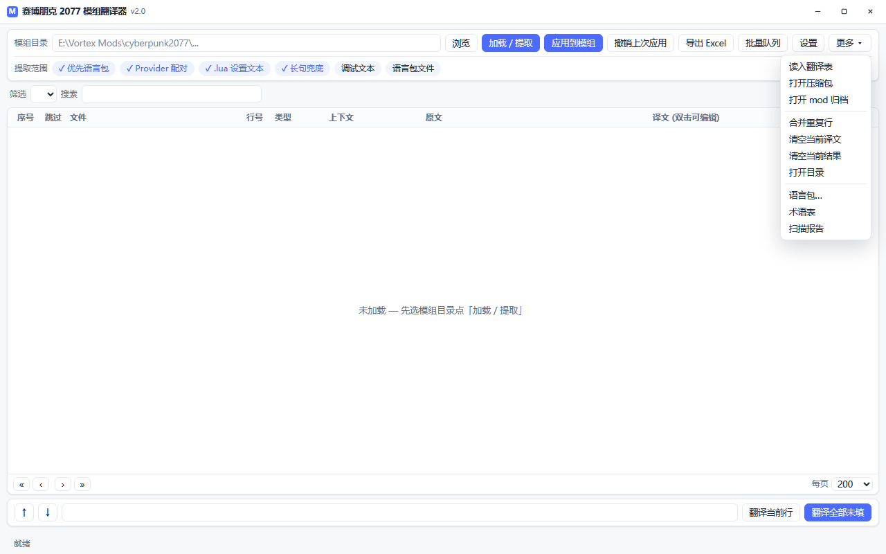

- 详见 `docs/P8精简误报.md`□

## v2.22 更新：分层提取（语言包不再「独占」一次加载）

有用户拿 *Much Better Contracts* 反馈：语言包里的剧□档位文本翻好了，□*模组设置界面
（CET 菜单里的开关名、说明、下拉选项）一条都没进表格**□

根因不在提取器，在调度：`_do_load()` 一旦配□Provider 语言包就 `return`□
`.lua` / `.reds` 里的设置文本根本没机会被扫到。v2.22 把提取拆成两层并合并成一张表□

- **两层合并**：语言包层（Provider 配对 / 普通语言包）+ 源码层（CET `.lua`□
  `@runtimeProperty`、`this.Text`、通知文本）。同一文件只会出现在一层里□
  语言包文件按相对路径从源码层排除，不会重复提取□
- **REDscript 证据分级**：以前「任何可翻译字面量」都当界面文本，逻辑重的模组会混□
  几千条内部状态字符串。现在按**赋值目标名 + 调用□*判断□

  | 证据 | 判定 | 收起 |
  |---|---|---|
  | 赋值给 `title` / `message` / `label` 这类名字 | 显示名称 / 界面文本 | 总是 |
  | `@runtimeProperty` / `this.Text` / `StrReplaceAll` | 结构化证□| 总是 |
  | 赋给 `m_issue` / `m_error`，或出现□`Log`/`MBCInfo` 等日志调用里 | 内部文本 | 需开「调试文本□|
  | 其它（数据表里的名称、句子） | 长句文本 | 受「长句兜底」控□|

- **新增「调试文本」开□*（默认关）：把内部状态与日志字符串一起收进来□
  想全量看一遍时再打开□
- **实测**（Much Better Contracts 2.1□,539 条语言□+ 30 个源码文件）□

  | 开□| 语言□| 源码/设置 | 合计 |
  |---|---|---|---|
  | 默认 | 1,539 | 1,926 | 3,465 |
  | 关掉长句兜底 | 1,539 | **287** | 1,826 |
  | 打开调试文本 | 1,539 | 3,262 | 4,801 |

  旧行为是 1,539 / 0（设置文本整片缺失）。设置界面那 29 条（`addTab` / `addSwitch` /
  `addSelectorString` / `addRangeFloat`）在三种组合下都在，回填 29/29 命中□
  `GetLocalizedTextByKey(...)` □key 不会被误改□
- 一并收掉的还有 `StringToName("MBC-Operation-Misfire-Stage")` 这类**记录□*□
  详见 `docs/P6分层提取.md`□

## v2.21 更新：批量队列 + 版本迁移

单个 mod 的链路在 v2.20 已经通了，但实际使用是一百来□mod，且它们会更新□

- **批量队列**：扫描游戏里已安装的 mod，勾出有本地化资源的条目，一次排□
  （扫□□填译 □机翻 □组包 □校验）。单个失败不影响其他，随时可取消□
  产物只写输出目录□*不会自动装进游戏**□
- **探测缓存**：探测只用通配符解□JSON，实测平□**3.1 □□*，且与归档体□
  基本无关□97 MB 的包也只□2.1 秒）。结果按 mtime/size 缓存，第二次打开秒出□
- **版本迁移**：每次组包后□`entryId` 记录 `[原文, 译文]` 快照。mod 更新□
  未变的条□*直接复用旧译文、不调模□*，只翻新增与改动，并报告新增/改动/删除□
  实测同一 mod 连跑两次，第二次机翻 0 条□
- **富文本标签兜□*：发□`tags_match()` 写了却从未被调用。批量是无人值守的，
  模型偶尔会吞□`<Rich ...>` 标签，现在一旦对不上就丢弃该条译文、保留原文，
  并在队列里显示「标签不□N（留原文）」□
- **回归**：探□缓存/迁移复用/API 守卫/界面元素 id/真实模型端到□全部通过□

## v2.20 更新：CR2W 资源模式（含字幕）+ 官方双语语料

前面的版本只翻译「人能读到的源文件」（`.reds` / `.json` / `.lua`）。但很多模组的文□
是编译进 `.archive` 里的 **CR2W 二进制资□*，扩展名却还□`.json`，源文件里根本没有□
v2.20 新增第二条翻译通道处理这类内容□

- **资源模式**：解□`.archive` □找出其中□CR2W 本地化资□□提取成表□□填译□□
  重新打包□*新的** `<mod>_zh-cn.archive` + `<mod>_zh-cn.archive.xl`，用 `extend:` 挂到□mod 上□
  **绝不改写□mod**，原 mod 更新后重新建一次即可□
- **支持三类资源**：`onscreens`（UI/物品/技能名）、`subtitles`（字幕）、以及字幕必需□
  注册□`PersistenceSubtitleMap`（只给文本文件会被游戏判定为资源加载失败）□
- **字幕可以覆盖原文**：实测确认追加的条目会顶掉同 `stringId` 的已有文本，
  所以归档里只放**改动过的条目**，几□KB 而不是几 MB。详□`docs/P5字幕覆盖.md`□
- **官方双语语料**：从游戏官方语言包（基础 + 往日之影）对齐□**164,357 □* en→zh□
  加载时自动填充能整句命中官方译文的行，并从语料里挖出 **2,720 条术□*
  （`sandevistan=斯安威斯坦`、`dogtown=狗镇`）喂给机翻□
  优先级：用户翻译记忆 □官方语料 □机翻□
- **两种模式共用一张表**：按行类型自动分派，同一个窗口里既能改源文件也能改归档资源□

一键安□卸载写在设置里，产物落在 `<程序目录>\userdata\output\`□
**只有显式点「安装」才会碰游戏目录**□

## v2.19 更新：Provider 自动配对 + 撤销上次应用

- **□Provider 自动配对语言□*：扫□`ModLocalizationProvider` 的语言分支，例□
  `case n"en-us": return new English();`，再□module / `import` 精确解析到对应的
  `English.reds`，自动生成「源语言□□Provider □目标语言包」关系□
- **不再按文件名猜配□*：同模块类优先，其次是显□`import`，最后才□
  `import ...*`。多□import 中存在同名类时标记为歧义并跳过，不会随便选一个□
- **提取时只收配对源□*：Provider 配对模式只接□Codeware `.reds` 语言包；
  MCM JSON、Lua 等仍按原逻辑提取。未配对□Provider 会在状态栏提示□
- **应用时锁定精□Provider**：提取得到的 Provider 路径会用于写回，只修改真正负责该语言包的
  Provider，不再扫描同目录所□Provider 后逐一修改□
- **撤销上次应用**：每次写回前保存受影响文件快照（包括目标文件、Provider、`.bak` 状态）□
  点击「撤销上次应用」可恢复原文件，并删除本次新建的目标文件□`.bak`□
  撤销记录持久化到 `<程序目录>\userdata\undo`，关闭程序后仍可使用□
  同一模组最多保留最□30 次写回记录，可连续撤销□
- **回归自测**：新□Provider 同模块配对、嵌□`import *` 配对、同□import 歧义检测□
  精确写回以及撤销恢复测试□

v2.19 主程□SHA256：`A96DC204E3645C61E09E0BE3B0E7188F4852F82D5F1718AFB105586A602D1A33`

## v2.18 更新：Codeware 翻译语言包自动注册

- **修复 `SYM_REDEFINITION`**：语言包模式在复制 `English.reds` 生成
  `ChineseSimplified.reds` 后，目标文件仍保□`public class English`，与源文件在同一□
  module 内重名，REDscript □
  `the name of this type conflicts with a type defined at ...`□
- **应用时自动改类名**：目标语言文件会改成唯一□`ChineseSimplified`（其它目标语言同理），
  不再复制源文件的 `English` 类名□
- **自动修改 Provider**：找到对应的 `ModLocalizationProvider`，在 `switch language` 中新□
  `case n"zh-cn": return new ChineseSimplified();`，确保翻译包真正□Codeware 加载□
- **兼容子目录与 import 写法**：支□`Packages/ChineseSimplified.reds` 这类文件□
  以及上层 Provider 通过 `import ...Packages.*` 引用语言包的模组□
- **安全与幂□*：修□Provider 前自动创□`.bak`；重复应用不会重复插□`case`□
  也不会改回源类名□
- **回归自测**：新增同目录 Provider、上□import Provider、重复准备不重复插入 case 的测试□

v2.18 主程□SHA256：`8DE11FD6FEAA383C78CEAB248705071B4D3835D2F5C3C1E8CCDBB18A4D7E729E`

## v2.17 更新：修复所有机翻失败

- **根因**：`Api.translate()` 中只在方法内□`import mt_client`，但真正执行翻译的是另一个方□
  `Api._run_translate()`，且运行在后台线程中。该线程没有 `mt_client` 这个名字，于是每次进□
  模型请求前都会报 `NameError: name 'mt_client' is not defined`，前端显示「机翻失败」□
- **修复**：在实际执行翻译□`_run_translate()` 内显式导□`mt_client`，确保后台线程能正常完成
  `/models` 查询□`/chat/completions` 批量翻译□
- **回归自测**：新增机翻工作线程测试，验证 `rows □progress □done` 事件链，且不再出□
  `mt_client` 相关□`error` 事件□
- **实机验证**：v2.17 单文件版加载 Much Better Contracts□539 条）后，机翻前两条成功返回：
  「Gigs □任务」「Operations □行动」，界面显示「机翻完□ 2 条」□

v2.17 主程□SHA256：`44A93586757D10D323774D351C6D48104A1A6401E3FDAB1C6A40D53A35BE5714`

## v2.16 更新：修复启动卡住 / 界面一直停在 v2.0

- **根因**：pywebview 启动时会递归遍历 `js_api` 对象的全部公开属性，再注入到 JS□
  `Api` 里原本有一个公开□`self.window`，于□pywebview 把整□Window / WebView2 COM 对象
  当成普通属性继续递归访问，触发大量跨线程 COM 异常，导致界面有时一直停□v2.0、窗口无响应□
- **修复**：窗口引用改为私有的 `self._window`；翻译记忆和术语表的懒加载属性也改为私有□
  避免启动时被 pywebview 反射遍历。JS API 对外暴露的方法保持不变□
- **效果**：不再输□`window.native.browser.webview...` 之类 COM 错误；本机从进程启动□
  前端 boot 完成□**1.1 □*，界面不会再停在未初始化状态□
- 回归自测增加检查：`Api` 不能暴露公开□`window` / `memory` / `glossary` 属性□

v2.16 主程□SHA256：`56756AF467078A806162AD063B227B317664BB49A12FE952F30C65B4AFC87988`

## v2.15 更新：清空当前内容 + 跳过部分翻译

- **清空当前译文**：保留当前提取出来的原文行和模组目录，只把「译文」列全部清空，方便重新翻译□
- **清空当前结果**：清空当前模组的所有提取行、译文、筛选和选择状态；不会修改模组文件，模组目录会保留□
- **逐行跳过翻译**：表格新增「跳过」勾选列。勾选后该行不会被机翻，也不会在「应用到模组」时写回□
- **右键菜单增强**：可跳过/恢复当前行、跳□恢复当前文件所有行、清空当前行译文□
- **筛选与统计**：筛选栏新增「已跳过 / 未跳过」，底部统计显示跳过条数□
- **Excel 保留跳过状□*：导出的翻译表新增「跳过」列，读回时自动恢复跳过标记；旧版无此列□Excel 仍可正常读入□

v2.15 主程□SHA256：`303409278486100D56C5CE6C4B84A6144343F253CFD2935944874D561227A399`

## v2.14 更新：多语言 StrReplaceAll 提取 + 启动优化

- **支持 `StrReplaceAll` 多语言替换□*：像 `perk-tooltip.reds` 这样□
  `// en`、`// zh-cn` 等注释排列十几国语言□`StrReplaceAll(description, "旧文□, "新文□)`□
  现在会先识别为语言表，只提取当前目标语言的那一条替换文本，不再□19 种语言全部塞进表格□
  □Expanded Dual Wielding，该文件□32 条重复条目缩减为 1 条简体中文条目，回填也只改这一处□
- **修复富文本被误判为路□*：`<Rich ...>双持</>` 这类无空格富文本包含 `/`，旧逻辑会把它当资源路径跳过；现在识别为富文本并正常提取□
- **启动优化**：翻译记忆、术语表和提□机翻模块改为按需加载，界面启动不再先解析□JSON□
  启动阶段 Python 模块加载耗时约从 172 ms 降到 96 ms，并显式指定 Edge WebView2 内核□
  深色模式在首帧前套用，减少启动闪白□
- 回归自测新增多语言替换表提□回填用例；Anti-Tracking Breach 67 条、MCM 319 条等原有结果保持不变□

v2.14 主程□SHA256：`23927CFFCE77192E35E393F2DB339D0D44AEEE38218AEAAFD2C889416B36121D`

## v2.13 更新：杀毒误报检查与单文件版

Microsoft Defender 曾把上一□onedir 主程序报□`Trojan:Win32/Bearfoos.B!ml`□

- 该名称带 `!ml`，属□Defender 的机器学习启发式判定，不是基于明确病毒特征的报法□
- 已检查源码、PE 导入表、PyInstaller 归档内容：没有下载器、持久化、读写浏览器数据、加密勒索、远程控制等行为；网络请求只用于用户配置的本地模□API□
- 旧版是未签名□PyInstaller + pywebview/pythonnet onedir 包，这类组合容易触发启发式误报□
- 已改用重新构建的**单文件版**，加□Windows 版本资源信息，并实际通过 Defender 文件扫描和启动测试□

新交付只□`2077模组翻译□exe`，不再需□`_internal\`。首次启动会稍慢 1□ 秒（单文件版需要解压到临时目录）□

v2.13 主程□SHA256：`2B0540E341AFD8DF10E96D895C21D3C470674CACFDDD2B83633214869C578691`

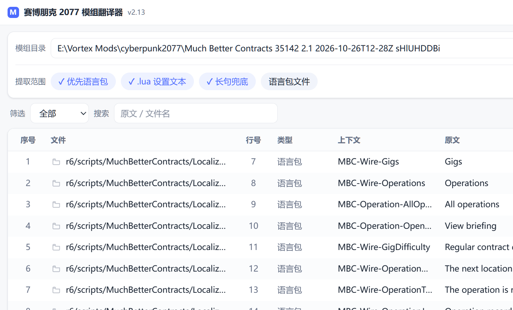

## v2.12 更新

- **应用失败明细弹窗**：应用模组时若有条目未写回，不再只提示一个失败数字；会弹出「应用失败列表」，逐条显示文件、行号、原文、译文、失败原因，并支持一键复制失败列表□
- **修复 Lua 回填只成功一部分**：`lang_of()` 以前返回带点□`.lua`，写回时扫描器没有按 Lua 模式跳过注释和长字符串，导致文件后段的个别字符串匹配不到。已改为返回 `lua`，同时修正了 Lua 长字符串 `[[...]]` 的偏移量 bug。Ket_CriminalTendencies 实测 52 条全部写回，0 失败□
- **提取逻辑增强**：支持识别本文件内自定义包装函数（如 `switch(path, label, desc, key)` / `rangeInt(...)`）的 label/desc 参数；支□`Util.Notify(...)`、`Toast`、`string.format(...)` 提示文本、`table.insert(found, ...)` 消息缓冲、`message = message .. "..."` 拼接片段，以□`LABELS` / `LABELS_BY_INPUT` / `RUMOURS` 这类提示表□
- 同一模组在目标语言为简体中文时，提取条数由旧版□5 条提升到 52 条，涵盖设置标签、传闻、通知和交互提示□

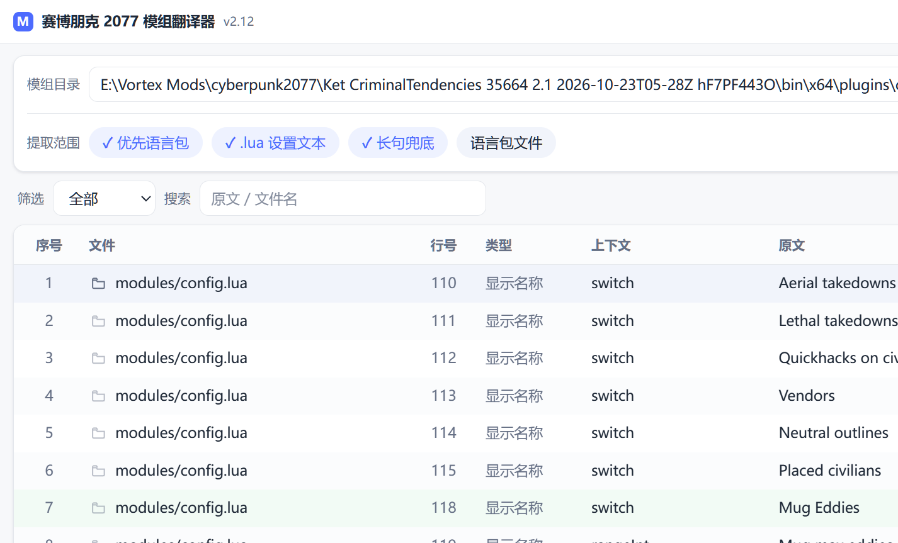

## v2.11 更新

- **提取时跳过当前目标语言文本**：目标语言设为简体中文后，已经是中文的条目不再进入「原文」列；`zh-cn.json`、`ChineseSimplified.reds`、`zh_CN.lua` 等目标语言文件也不会再被当成源文件。中□/ 日文 / 韩文 / 俄文 / 阿拉伯文可按字符范围识别；英语、法语、德语、西班牙语等拉丁字母语言只能通过「跳过目标语言文件」处理□
- **右键复制鼠标所在单元格**：右键任意单元格 □「复制此单元格（列名）」。复制的是该列的真实数据：文件列复制完整相对路径，译文列复制译文，原□上下□行号/类型/序号同理；剪贴板 API 不可用时自动回退□

---

## 目录结构

```
Module Translation/
├─ src/                      源码
□ ├─ web_app.py             □主程序入口（pywebview 后端 + js_api□
□ ├─ web/                   □前端（index.html / style.css / app.js□
□ ├─ mod_text_engine.py     提取/回填引擎（核心，可单独当库用□
□ ├─ text_noise.py          误报判定（资源转□记录□技术串/外文□双语表）
□ ├─ vortex_map.py          Vortex 活动映射（下载包/安装缓存/部署清单□
□ ├─ mt_client.py           本地模型(OpenAI 兼容)客户□+ 批量翻译
□ ├─ locale_pack.py         语言包识□抽取/生成目标语言文件
□ ├─ tm.py                  翻译记忆(SQLite 无关, □json)
□ ├─ glossary.py            术语□内置赛博朋克术语, 可导入导□
□ ├─ i18n.py                界面本地□文本即键)
□ ├─ ui_theme.py            DeepSeek 风格浅色主题(配色/ttk 样式/药丸开□
□ ├─ appconfig.py           两个前端共用的配□路径工具
□ ├─ mod_translate_gui.py   □Tkinter 界面（保留，v1.7□
□ └─ mod_translate.py       早期命令行版（保留）
├─ assets/
□ ├─ app.ico                程序图标
□ └─ app.manifest           DPI 感知清单（PerMonitorV2□
├─ docs/
□ ├─ 使用说明.txt           面向最终用户的说明
□ ├─ P1资源模式.md □P6分层提取.md   分阶段实现记□
□ ├─ P7应用到模□md        应用到模组：现有实现细节
□ └─ P8精简误报.md          误报分类规则 + 302 模组实测
□ └─ P9活动映射.md          下载□安装缓存/部署清单三层映射 + 失败回执
├─ samples/
□ └─ 示例翻译□xlsx        从真实模组提取的翻译表样□
□ └─ locales/               界面语言□zh-CN.json / en-US.json
├─ tools/
□ ├─ build.ps1              打包 exe（默□onedir，可□-OneFile□
□ ├─ run.ps1                从源码直接启□
□ └─ selftest.py            回归自测
├─ dist/                     打包输出
├─ build/                    打包中间文件（可删）
└─ backup/                   历史版本 zip
```

## 快速开始

```powershell
# 从源码运行（pywebview 版）
.\tools\run.ps1

# 打包成单文件 exe（推荐分发）
.\tools\build.ps1 -OneFile

# 或打包成 onedir 文件夹版
.\tools\build.ps1

# 回归自测（需要本机存在测试模组）
.\tools\selftest.py  # □python tools\selftest.py
```

单文件版直接分发 `dist\2077ModTranslator.exe` 即可；onedir 版则需□`dist\2077ModTranslator\` 整个目录一起拷走□

## 支持提取的文本

| 来源 | 识别方式 | 产出类型 |
|---|---|---|
| REDscript `.reds` | `@runtimeProperty("ModSettings.displayName", "□)` 只取□2 个参□| 模组□/ 分类 / 显示名称 / 描述 |
| Codeware 语言□| `this.Text("key", "value")` 只取□2 个参数，key 只作为上下文显示 | 界面文本 |
| 输入 `.xml` | 属性值与文本节点 | 界面文本 |
| Native Settings UI | `ui.addSwitch(path,'标签','描述')`、`addSelectorString`、`addTab`、`addSubcategory`、`addRangeInt/Float`、`addKeyBinding` □按参数位□| 显示名称 / 描述 / 分类 / 选项文本 |
| ImGui | `ImGui.Checkbox/Button/Text/TextWrapped/SliderFloat/Begin/Selectable/…` 按参数位□| 选项文本 / 界面文本 |
| Lua 表字□| `displayName = "□`、`Part.Name = "□`、`labels = {"A","B"}` | 显示名称 / 描述 / 选项文本 |
| 自定义包装函□| `local function switch(path, label, desc, key)` 后的 `switch(..., "标签", "描述", ...)` | 显示名称 / 描述 |
| 通知 / 提示文本 | `Util.Notify("□)`、`Toast(...)`、`string.format(...)`、`message = message .. "□`、`table.insert(found, "□)` | 界面文本 |
| 提示□| `LABELS`、`LABELS_BY_INPUT`、`RUMOURS` 等表里的字符□| 选项文本 |
| 多语言替换□| □`// en` / `// zh-cn` 注释□`StrReplaceAll(description, "□, "□)` 只取目标语言的新文本 | 界面文本 |
| 长句兜底（可关） | 未被上面规则命中的首字母大写长句（≥4 词） | 长句文本 |

### 明确跳过

- `r"□`（ResRef 资源路径）、`n"□`（CName）、`t"□`（TweakDBID）、`s"□` 前缀字面□
- 非富文本的资源路径（□`\` / `/`）、URL、`xx-xx` 语言码、纯标识符（`raj.inkfontfamily`）、十六进制颜□
- `StrReplaceAll` 多语言表中非当前目标语言的条目（避免同一条文本被提取十几遍）
- 注释（Lua `--`、REDscript `//` □`/* */`）、Lua 长字符串 `[[…]]`
- 语言包文件（`en_US.lua`、`English.reds`、`zh-cn.json` 等），默认跳过，可在界面勾选开□
- 当前目标语言文本（如目标为简体中文时，已是中文的条目），以及当前目标语言文件本身（v2.11）；
  □`StrReplaceAll` 语言表中主动选中的目标语言条目例外，便于校□修改模组已有译文

### 回填安全策略

1. □`(行号, 原文)` 定位到具体字面量，保留原引号类型□CRLF 换行
2. 译文中的 `"` `\` 换行自动转义
3. ImGui □`"文字##内部ID"` 只把 `##` 之前的部分给译者，写回时自动补回内□ID
4. 写盘前重新扫描校验，字面量数量异常则放弃
5. 先建 `.bak`（已存在则不覆盖）再□

## 架构（v2.0 重构）

```
Python 后端 (web_app.py)                前端 (src/web/)
├─ Api □ 通过 js_api 暴露□JS  <--->  index.html / style.css / app.js
├─ mod_text_engine / mt_client          □HTML/CSS/JS, 无框架、无构建步骤
├─ tm / glossary / i18n
└─ pywebview (Edge WebView2 内核)
```

- JS □`pywebview.api.load_mod(...)` 拿数据；长任务（批量机翻）在 Python 线程里跑□
  □`window.evaluate_js("window.__evt(...)")` 把进□结果推回前端
- 页面在启动时□CSS/JS 内联□HTML 再交□pywebview 渲染□
  不依赖本□HTTP 服务（更稳，也不会占端口□
- 窗口是无边框的，标题□按钮自绘；拖动、双击最大化、右下角缩放都通过 js_api 转给 pywebview

## 界面风格

卡片式（参□DeepSeek 网页端）□*浅色 / 深色两套**，菜单「设□□深色模式」即时切换并记住选择□

| | 浅色 | 深色 |
|---|---|---|
| 背景 / 卡片 | `#F7F8FA` / `#FFFFFF` | `#17181C` / `#1F2126` |
| 主色 | `#4D6BFE` | `#6E86FF` |
| 描边 | `#E4E7EC` | `#2E3138` |
| 选中□| `#E8EEFF` | `#2C3350` |

表格斑马纹、行悬停高亮、浅蓝选中、表头加粗；提取范围用「药丸开关」；按钮分主（蓝底）/次（描边）两级□
两套配色与全□ttk 样式集中□`src/ui_theme.py` □`LIGHT` / `DARK` 字典，改一处即可全局换肤□

窗口也是自绘的（v1.6）：□Win32 `SetWindowLongPtr` 去掉 `WS_CAPTION`、保□`WS_THICKFRAME`□
所以拖□/ 双击最大化 / Aero Snap / 边缘缩放仍然由系统完成，只是标题栏和菜单栏换成自绘□
接口失败时自动退回系统标题栏□

示例（深色）□

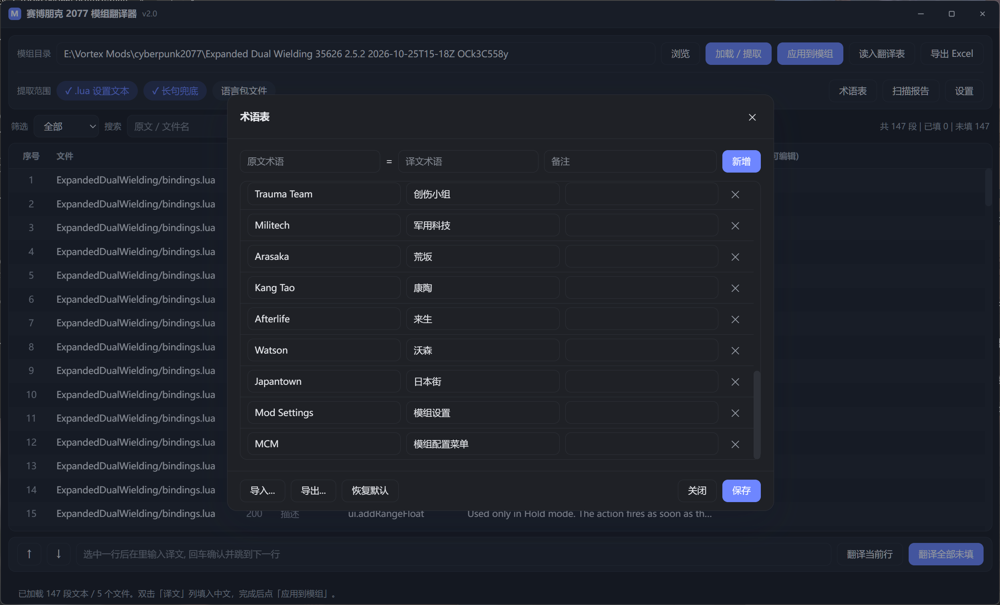

## 界面

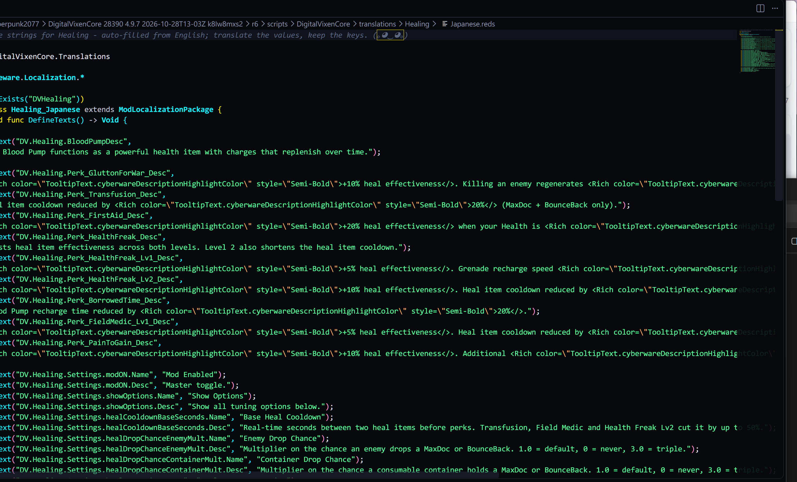

设置对话框（本地模型 API 地址 + 连通性测试）□

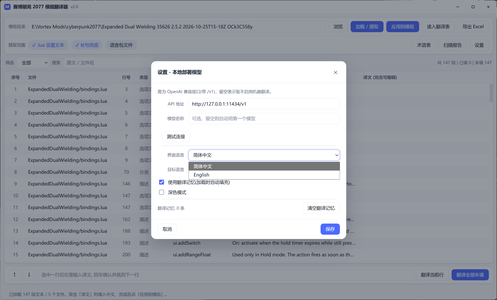

## 响应性（v2.3）

所有耗时操作都跑□Python 后台线程里，js_api 立即返回，结果用 `window.__evt(...)` 推回前端□

| 操作 | 之前 | 现在 |
|---|---|---|
| 加载/提取 | 同步阻塞 js_api 调用 | 立即返回 □`busy` 事件 □`loaded` 事件 |
| 应用到模□| 同步，逐条读写文件 | 立即返回 □`applied` 事件；同文件合并写一□|
| 批量机翻 | 已有后台线程 + 进度事件 | 不变 |

界面在处理期间显示遮□+ 转圈 + 禁用按钮，不会再出现「未响应」□

另外加了**单实例保□*（命名互斥量）：重复启动时第二个实例只弹提示就退出，
避免两个进程□WebView2 / pythonnet 运行时，出现
`Failed to start embedded python interpreter!` 或卡死□

## Codeware `this.Text` 语言包兼容（v2.10）

识别 Codeware `ModLocalizationPackage` 里的写法□

```reds
this.Text("MBC-Nem-Maelstrom-0", "Static");
```

- 只提取第二个参数 `"Static"`，第一个参□`"MBC-Nem-Maelstrom-0"` 只显示在「上下文」列，不再被当成译文
- 单词值（`Static` / `Gigs` / `Chrome`）也会收□
- 支持换行写法：`this.Text(
  "key",
  "value"
);`
- 文件名带语言后缀的布局也能识别，例□`BoardEnglish.reds` □目标 `BoardChineseSimplified.reds`，不会互相覆□
- Much Better Contracts 实测□ 个语言包文件共 **1539 □*□320 / 48 / 48 / 49 / 64 / 10□
- DigitalVixenCore 同样使用该格式：31 个文件从旧版误收 key □4378 条修正为 **5088 □*，补□710 条单词译□

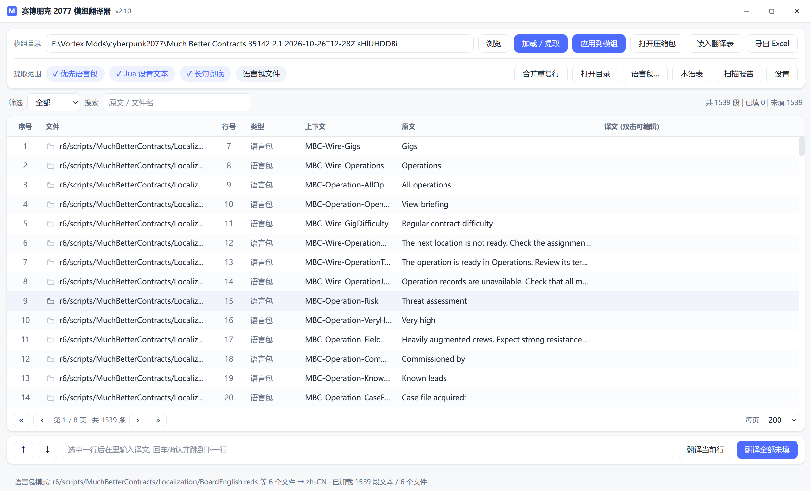

## 隐藏/显示译文（v2.9）

在表格里右键任意一行，菜单新增□

| 菜单□| 作用 |
|---|---|
| 隐藏已翻译的□| 过滤掉所有已有译文的行，只留待翻译内□|
| 只显示已翻译的行 | 反向查看，只保留已有译文的行 |

再次点击同一项即可恢复；筛选行右侧显示「已隐藏已翻译□「只显示已翻译」，
点「显示全部」可同时清除按文件隐藏、只显示某文件、译文状态筛选□
统计/分页/搜索/机翻/导出/应用都以当前可见集合为准□

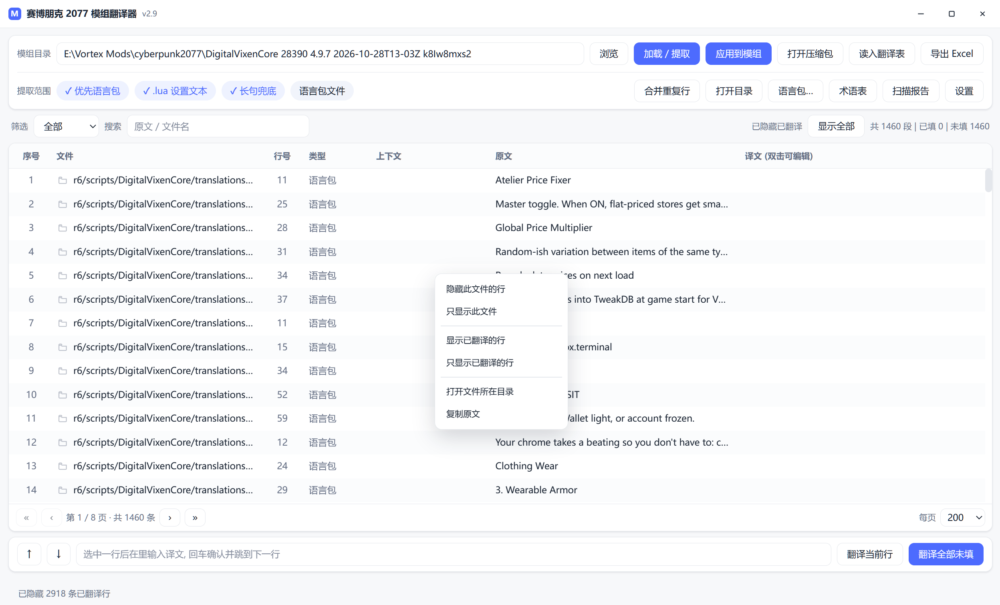

## 隐藏/显示同一文件的行（v2.8）

表格□*右键任意一□*□

| 菜单□| 作用 |
|---|---|
| 隐藏此文件的□| □`file` 的全部行从视图移□|
| 只显示此文件 | 反向操作，只保留该文□|
| 打开文件所在目□| 资源管理器定位到该文□|
| 复制此单元格（列名） | 复制鼠标所在列的真实文本（v2.11□|
| 复制原文 | 复制该行原文到剪贴板 |

筛选行右侧会显示「已隐藏 N 个文□· [显示全部]」，统计/分页/机翻/导出都以当前可见集合为准□
换模组或重新加载会自动清空隐藏状态□

## 合并重复行（v2.7）

同一文件□原文"相同的行可以合并成一行：翻译一次，应用时自动写回该文件里的所有重复位置□

- 工具栏「合并重复行」↔「还原重复行」切换；合并后序号旁显示 `×N`
- 机翻只发送合并后的唯一文本，省 token 也省时间
- 导出 Excel、应用到模组都会□`dups` 展开，不会漏□
- 合并键是 `(文件, 原文)`，跨文件不合并（不同文件的同□key 可能语义不同□

## 打开目录 & 分页（v2.6）

- 文件列每行带一个文件夹图标，点击用资源管理器定位到该文件（`explorer /select,"□`）；
  工具栏「打开目录」在没有选中行时打开模组根目□
- 表格分页：每□100/200/500/1000 可切换，底部显示「第 X / Y □· □N 条」；
  筛选、搜索、重新加载都会重置到□1 页；「上/下一行」跨页时自动翻页□
  5088 行的模组只渲染当前页，滚动和大列表操作明显更流畅□

## 多语言包（v2.5）

有些模组按子模块分文件夹，每个文件夹一套语言文件（如 DigitalVixenCore □
`translations/<模块□/{English,ChineseSimplified,...}.reds`，共 31 套）□

- 加载时把**所□*源语言文件一次抽完（31 □English.reds □5088 条，0.3 s□
- 目标文件已存在时，自动带出其中的**现有译文**（json □key，reds/lua 按顺序对齐），便于直接修□
- 回填按文件批量写□088 □/ 31 个文□□0.1 s
- 目标文件排版与源文件不一致时，`apply_many` 依次尝试「行□原文 □原文 □行号」三种匹□

## 提取顺序（v2.2）

「加□/ 提取」默□*先找语言□*□

1. 扫描 `locales/*.json`、`en_US.lua`、`English.reds` 等语言□
2. 找到 □自动用英文包作源、按设置里的「目标语言」生成目标文件，状态栏显示
   `语言包模□ □en-us.json □zh-CN`
3. 没找□□退回扫文件内容（`.reds` / `.xml` / `.lua`），状态栏显示 `内容模式`

开关「优先语言包」默认开启；关掉后强制走内容模式。想换源语言/目标语言仍可点「语言包…」手动选□

两种模式都会跳过当前目标语言文本：例如目标语言为简体中文时，已存在□
`locales/zh-cn.json`、`ChineseSimplified.reds` 不会作为源文件，源码中已经是中文□
字符串也不会进入表格。状态栏会显□`已跳□N 条目标语言文本`□

## 压缩包 & 语言包模式（v2.1）

**压缩□*：路径框可以直接□`.zip`，或点「打开压缩包」。后端用 `zipfile` 解到
`%TEMP%\2077mt_<包名>` 再走正常流程；回填后点「打包为 zip」把工作目录重新打成新包□
原压缩包不改动（实测 11 KB 的模组包解压→回填→重打包，结构与体积一致）□

**语言包模□*：点「语言包…」，自动扫描模组里的本地化文件：

| 形□| 例子 | 写回方式 |
|---|---|---|
| 扁平/嵌套 JSON | `locales/en-us.json`、`locales/zh-cn.json` | □key 路径写进目标文件 |
| Lua □| `en_US.lua` | 复制源文□□按行替换 |
| REDscript | `English.reds` | 复制源文□□按行替换 |

源文件永远不动；目标文件不存在就新建，已存在就更新□
`locale_pack.py` 负责语言标签识别（`zh_cn` / `chinesesimplified` / `zh-cn` 都归一□`zh-CN`□
和目标文件名生成（`zh-CN` □`zh-cn.json` / `zh_CN.lua` / `ChineseSimplified.reds`）□

实测：MCM 模组 en-us.json 244 □□写入 zh-cn.json；DigitalVixenCore □
`English.reds` □生成 `ChineseSimplified.reds`□

## 本地化 / 翻译记忆 / 术语表（v1.7）

**界面语言**：`设置 □界面语言`，内□简体中□/ English，首次启动跟随系统□
语言包是 `src/locales/*.json`（`{"code","name","strings":{"中文原文":"译文"}}`），
把自制的 json 放进 `<程序目录>\userdata\locales\` 即可增加语言，无需改代码□
源码里用 `tr("中文原文")` 取词，缺译文自动退回中文□

**翻译记忆**：`<程序目录>\userdata\memory.json`□
机翻结果自动入库；加载模组时自动套用（设置里可关）；批量机翻时先查记忆再请求模型□
状态栏会显示「其□N 条来自翻译记忆」。`工具 □清空翻译记忆` 可清空□

**术语□*：`<程序目录>\userdata\glossary.json`。`工具 □术语表` 增删改，
内置 Quickhack=快速破解、Cyberware=义体 □28 条；机翻时只□*当前批次里出现过的术□*
注入提示词，避免提示词过长；支持 txt 导入导出（每□`原文=译文`）□

**目标语言**：设置里可□简体中□/ 繁體中文 / English / 日本□/ 한국□/ Русский /
Español / Deutsch / Français，机翻按目标语言输出，记忆按目标语言分开存□

## 设置（本地模型 API）

菜单栏「设□□本地模型 API 地址…」，或工具栏右上角「设置」□

| □| 说明 |
|---|---|
| API 地址 | OpenAI 兼容接口，如 `http://127.0.0.1:11434/v1`（Ollama）、`http://127.0.0.1:1234/v1`（LM Studio）、`http://127.0.0.1:8000/v1`（vLLM）。缺 `http://` 自动补，末尾 `/` 自动□|
| 模型名称 | 可选，留空则取 `/models` 返回的第一□|
| 测试连接 | `GET <地址>/models`，显示可用模型列□|

配置文件：`<程序目录>\userdata\settings.json`

```json
{
  "api_base": "http://127.0.0.1:11434/v1",
  "model": ""
}
```

### 机翻（v1.3□

配置好地址后，底部有「翻译当前行」「翻译全部未填」，菜单「工具」里也有□

- 批量□8 条一批走 `/chat/completions`，模型返回不是合□JSON 时自动退回逐条翻译
- 提示词要求保□`%s %d %q {name} <Rich □ </>` 等占位符与转义，并统一术语（Quickhack=快速破解、Cyberware=义体、Perk=专长…）
- 批量时按钮变「停止机翻」，点了立即停，已翻好的保留
- 结果只写进表格，仍要点「应用到模组」才落盘（先备份 .bak□

`src/mt_client.py` 是独立模块，只依赖标准库，可单独调用□

```python
import mt_client
mt_client.translate_one("http://127.0.0.1:11434/v1", "qwen2.5:7b", "Hello")
mt_client.translate_batch("http://127.0.0.1:11434/v1", "qwen2.5:7b", ["a b", "c d"])
```

## 资源模式：翻译 archive 里的 CR2W 文本（v2.20）

### 什么时候用

模组□UI 文案、任务目标、字幕常常不在源文件里，而是编译□`content/**.archive`
□CR2W 资源（扩展名仍是 `.json`，但内容是二进制）。在源文件里搜不到这些文字时□
就是需要用资源模式的时候□

界面上「资源模式」和源文件模式共存于同一张表，按行自动分派，不需要切换项目□

### 产物长什么样

```
output\<mod>_zh-cn.archive       我们自己的资源，只含改动过的条目
output\<mod>_zh-cn.archive.xl    声明资源，并 extend 到原 mod □.xl
```

`extend:` 让两份配置共存，所以原 mod □en-us 不会被删、mod 一更新重新建一次即可□
实测一□62,000 □onscreens 的模组，只改 66 条时归档是几□KB 而不是几 MB□

### 字幕为什么要两个文件

字幕是「注册表 + 文本」成对的结构□

| 文件 | 类型 | 作用 |
|---|---|---|
| `*_map.json` | `localizationPersistenceSubtitleMap` | 告诉游戏「还有一份字幕文本要读□|
| `*_entries.json` | `localizationPersistenceSubtitleEntries` | 真正□`stringId □译文` |

只给文本文件，游戏日志会□`Resource "..." failed to load` 而静默失败□
注册表里的路径必须写□`subtitleFile.DepotPath.$value`，写□`subtitleFile.$value`
会让打包直接失败□

### 字幕能覆盖原文（实测□

ArchiveXL 把我们的字幕条目**追加**到列表末尾（源码□`PushBack`，不去重也不改写），
所以「能不能顶掉原文」取决于游戏侧的索引方向。P5 用「把全部官方 `stringId` 改成同一□
ASCII 标记」的方式实测，同一条狗镇广播在补齐覆盖集后从原文变成了标记，确□*后者胜**□

结论：差异式归档对字幕成立，不需要整文件替换。完整经过（包括第一轮为什么得出过相反
的错觉）□`docs/P5字幕覆盖.md`□

注意由此产生的两条使用约束：

- **重装前先卸载**。残留的旧归档如果加载更晚，会盖掉新译文□
- **和其他翻□mod 冲突时胜负由加载顺序决定**，不由本工具控制□

### 官方双语语料

设置里可以「构建官方语料」，从游戏自带的语言包对齐出**官方译法**□

| □| 数量 |
|---|---|
| onscreen □| 69,758 |
| 字幕□| 94,599 |
| 合计 | 164,357 |
| 术语□| 2,720 |

两种用法□

1. **整句命中**：加载时自动填充官方已有译文的行。命中率□10%（模组文案多为原创）□
   属于「白捡的准确译文」，不能替代机翻□
2. **术语一致□*：把文本里实际出现的官方术语拼进机翻提示词，
   例如 `以下术语建议沿用游戏官方译法：sandevistan=斯安威斯坦；dogtown=狗镇`□
   这部分比整句命中更有价值□

语料□`<程序目录>\userdata\official_tm.sqlite`（约 43 MB，构建约 45 秒）□
基础游戏和往日之影的语言包都会读——少读一个，狗镇□2 万多条字幕就会静默缺失□

### 已知限制

- 归档□mod 的自动配对成功率□91%□5/82），剩下需要手动指□`.archive`
- 只支□en-us □zh-cn
- 写回是「新建归档」，不会改原 mod；要撤销直接卸载产物即可

## 批量队列与版本迁移（v2.21）

### 打开方式

主工具栏「批量队列」→「扫描已□mod」。首次扫描约 8 分钟□59 □`.xl`），
之后走缓存秒开；mod 更新后会自动重探那一个□

### 队列做什□

对每个勾选的 mod：扫描归□□填译（翻译记□/ 官方语料 / 上次快照□
□机翻剩余 □组包 □校验。产物写□`<程序目录>\userdata\output\`□
**不会自动装进游戏**——批量往游戏目录塞几十个包，出问题太难收拾，
所以安装始终是手动一步□

- 名字□`_zh-cn` 结尾□`.xl` 会被跳过，避免把自己的成品再翻一□
- 某个 mod 失败只标红那一条，队列继续
- 取消在两□mod 之间、以及每 8 条机翻之间生□

### 版本迁移怎么算「变了□

不用文本比对，用 `entryId`：原文改一个标点就是新句子，按文本比会把它当新条目重翻□

| 情况 | 处理 |
|---|---|
| id 在、原文相□| 复用旧译文，不调模型 |
| id 在、原文变□| 重新翻译 |
| id 不在 | 新增，翻□|
| □id 消失 | 计入「删除」，出包时自然不□|

实测同一□mod 连跑两次□

| | 新增 | 相同 | 复用 | 实际机翻 |
|---|---|---|---|---|
| 第一□| 11 | 0 | 0 | 11 □|
| 第二□| 0 | 11 | 11 | **0 □* |

### 富文本标签会被强制校□

模组文案里的 `<Rich color="...">` 之类标签，模型偶尔会吞掉或改坏□
批量是无人值守的，坏标签进游戏会让 tooltip 直接露出源码，所以：

- 每条机翻译文与原文比对标□
- 对不上就**丢弃该条译文、保留原□*（显示英文，但格式正确）
- 队列行显示「标签不□N（留原文）□

比对只锁标签的种类与次数、不锁顺序——中文语序和英文不同，整块标签跟着从句搬家是合理的□

### 已知限制

- 快照文件只增不减，目前没有清理入□
- 不检测跨 mod 的术语冲□
- 机翻按顺序串行（每批 8 条），几十个 mod 一起跑会比较久

## 已知限制 / 后续

- [ ] `locales/*.json` 语言包暂不提取（仅提示数量），计划支持「英文键 □中文包缺失项」比□
- [ ] 语言包文件（`English.reds` / `zh_CN.lua`）目前只能整体提取，不能「从英文包翻译后写入中文包□
- [x] 本地模型 API 配置 + 连通性测□
- [x] 翻译当前□/ 翻译全部未填（批□+ 失败回退 + 可中断）
- [x] 术语□/ 翻译记忆（同一原文只翻一次，跨模组复用）
- [x] CR2W 资源模式 + 字幕 + 官方双语语料（v2.20□
- [x] 批量队列 + mod 版本迁移（v2.21□
- [x] Vortex 活动映射：只翻生效目录、识别「有更新待装」（v2.24□
- [x] 翻译失败回执 + 「继续翻译剩下的」（v2.24□
- [ ] 尚未支持批量遍历整个 Vortex 目录并分别出表（活动映射已能筛出该翻哪些□

## 技术备注

- Python 3.10+，仅依赖 `openpyxl`（打包时□PyInstaller□
- 默认构建 onedir；`-OneFile` 构建单文件版。v2.13 起单文件版已实测可用，并用于避免 PyInstaller onedir 的杀毒误报；v2.14 继续使用单文件交□
- □DPI：Tk `scaling / (96/72)` 得到缩放比，所有尺寸按比例放大
- 界面线程与提取线程通过 `queue.Queue` + `root.after(80, poll)` 通信，禁止在子线程调□Tk

