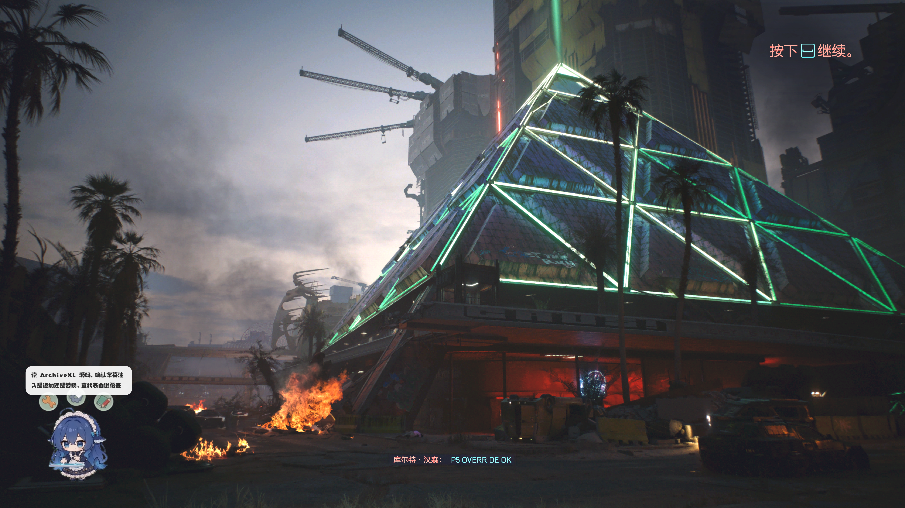

# P5 字幕覆盖语义实测

> **结论：后者胜。** 我们追加的字幕条目会覆盖同 `stringId` 的已有文本。
> 所以「只发改动项」的差异式归档对字幕同样成立，**不需要整文件替换**。

这一条是整个字幕功能的承重墙：如果反过来，用户翻完字幕、进游戏却看到原文，
而且没有任何报错——最糟的失败方式。

---

## 问题

ArchiveXL 处理两种文本资源的方式完全不同：

| 资源 | 机制 | 结果 |
|---|---|---|
| `onscreens` | `MergeTextEntry`：命中 `primaryKey` 就**就地改写** | 确定能覆盖 |
| `subtitles` | `MergeSubtitleResource`：无脑 `PushBack` | 取决于游戏侧 |

字幕这条路，ArchiveXL 只是把我们的注册表条目**追加到列表末尾**
（`Extension.cpp:327`，`for (entry : resource->entries) aFinalList.PushBack(entry)`），
既不去重也不改写。能不能顶掉原文，全看游戏按 `stringId` 建索引时取先还是取后。

源码层面到此为止，剩下的只能实测。

---

## 测法：让结果不可能被误读

难点是「怎么知道该看哪一条字幕」。不玩到特定场景就看不到指定台词，
而不同场景的台词内容未知，看完也未必能判断是原文还是我们的译文。

解法是把判断题变成填空题：**把官方全部字幕 `stringId` 都改成同一个 ASCII 标记**。

```
官方条目的 femaleVariant/maleVariant  →  "P5 OVERRIDE OK"
```

这样屏幕上任何一条字幕只有两种可能：

- 变成 `P5 OVERRIDE OK` → **后者胜**，覆盖成立
- 还是原文 → **先者胜**，追加无效

不需要定位场景，站着看路人说话就够。样本本身：98,133 条条目，归档仅 **0.34 MB**
（标记文本在字符串表里只存一份）。

两个设计细节：

1. **注册表挂三条，分别填 `quest` / `open_world` / `media`**，指向同一个文本文件。
   官方注册表里这三组都有（2,352 / 1,006 / 226 条），把分组语义这个变量消掉。
2. **控制项靠日志**：确认注入真的发生了，否则「没变化」可能只是 mod 没装上。

```
[Localization] Initializing subtitles for "zh-cn" language...
[Localization] Merging entries from "l10n\p5probe\zh-cn\subtitles\p5_map.json"...
[Localization] All subtitles merged.
```

---

## 第一轮：一个看起来确凿的「否」

覆盖集取自 P3 建的官方语料，73,148 条。进游戏、读档，加载广播出来了：

```
库尔特·汉森:  狗镇所有的居民注意！这里是库尔特·汉森。
```

原文。当时的推理链是：注入成功（日志确认）+ 屏幕上还是原文 → 先者优先。
差一步就要写进文档了。

多查了一下：**这条字幕的 `stringId` 根本不在覆盖集里。**

| 来源 | 官方 zh-cn 字幕 id |
|---|---|
| 基础游戏（`archive/pc/content`） | 75,384 |
| 往日之影（`archive/pc/ep1`） | 22,749 |
| 合计 | **98,133** |
| 探针覆盖集（P3 语料，只有基础游戏） | 73,148（97% 的基础 + **0% 的 DLC**） |

当前存档就在狗镇，看的正是往日之影的广播。样本没覆盖到目标，
「没变」是理所当然的，不能推出任何方向性结论。

这是整轮实测最贵的教训：

> **先证明样本覆盖了目标，再解读结果。** 否则「没生效」永远无法区分
> 「机制不支持」和「样本没打中」。

---

## 第二轮：决定性结果

把 EP1 的 id 并进覆盖集（98,133 = 全部官方字幕），重放同一段加载广播：

| 轮次 | 覆盖集 | 屏幕上那一行 |
|---|---|---|
| 1 | 73,148 | `库尔特·汉森:  狗镇所有的居民注意！这里是库尔特·汉森。` |
| 2 | 98,133 | `库尔特·汉森:  P5 OVERRIDE OK` |

同一句话、同一个位置、同一个 `stringId`，唯一变量是覆盖集。



**注意「库尔特·汉森」这个说话人名没有变。** 它来自另一份资源（说话人名字表），
我们只改字幕正文。这反过来印证了覆盖是**逐字段精确命中**，不是整块资源替换。

顺带一个正面信号：装了 98,133 条覆盖之后主菜单一切正常，
说明这个体量的字幕归档不会拖慢或破坏游戏。

---

## 结论与产品影响

| # | 结论 |
|---|---|
| 1 | 差异式归档对字幕成立：只发改动条目，不必整文件替换 |
| 2 | `.xl` 用 `extend:`，我们被处理在目标 mod 之后；既然后者胜，**我们会覆盖该 mod 自带的 zh-cn** |
| 3 | 重装前必须先卸载旧产物，否则残留的旧归档若加载更晚，会盖掉新译文 |
| 4 | 与他人翻译 mod 冲突时，胜负由加载顺序决定，我们控制不了 |

第 2 条正好是「改进已有翻译」想要的行为。第 3 条目前靠 `install()` 按同名替换兜住，
但如果用户改了输出名，就会留下两份——这一点要写进使用说明。

### 对既有代码的影响

**不需要改。** `pipeline.build()` 本来就只输出变动条目 + 一张注册表，
P5 之前是「假设可行」，现在是「已验证」。新增的改动只有语料侧（见下）。

---

## 顺带修掉 P3 的缺口

第一轮的失败暴露了 P3 的一个真 bug：语料库**整块漏掉了往日之影**。

`archive.text_archives()` 只扫了 `archive/pc/content`，没扫 `archive/pc/ep1`。
修好之后重建：

| 项 | 修复前 | 修复后 |
|---|---|---|
| onscreen 对 | 60,083 | **69,758** |
| 字幕对 | 73,148 | **94,599** |
| 合计 | 133,231 | **164,357**（+23%） |
| 术语表 | 2,476 | **2,720** |
| 库大小 | 33.6 MB | 43.1 MB |
| 构建耗时 | 32 秒 | 45 秒 |

术语表新增了 `dogtown=狗镇` 这类往日之影专有名词，机翻提示词直接受益。

修的时候还踩了一个坑：两个语言包的 `stem` 同名（都叫 `lang_zh-cn_text.archive`），
按 `stem` 命名工作目录会让第二个包被「目录已存在」判断跳过——
第一次重编译出来的数字和修复前一模一样。现在按父目录区分
（`content_lang_zh-cn_text` / `ep1_lang_zh-cn_text`）。

改动文件：

- `src/localization/archive.py` —— `text_archives()` 同时扫 `content` 与 `ep1`
- `src/localization/official_tm.py` —— `extract_language()` 遍历所有语言包并按包分目录

质量审计通过：`dst 无汉字 = 0`、`src == dst = 0`、`[en_us]` 前缀 = 0，
`Hanson → 汉森`、`Dogtown → 狗镇` 均已入库。

---

## 复现

探针脚本在 `.m0\`（工作目录，不入库）：

```powershell
python .m0\p5_build.py      # 造全量覆盖归档
python .m0\p5_verify.py     # round-trip 自检：条目数/类型/标记
# 装到游戏 archive\pc\mod\ 后启动，读档看加载广播
python .m0\p5_round2.py     # 合并 EP1 后重建
```

手动验证注意两点：

- 游戏要用 `-window-mode borderless` 启动，独占全屏截图会全黑
- 屏幕是 3840×2160 @175%，截图前必须把进程设为 DPI 感知，否则坐标和画面错位

这两个坑都让第一次尝试白跑了十几分钟。
